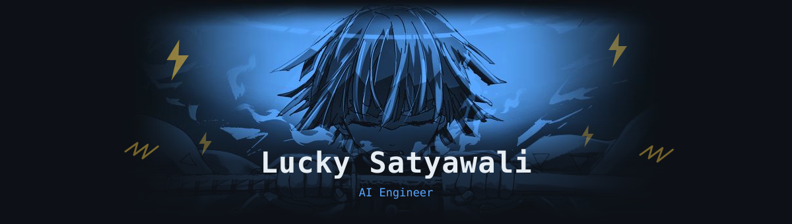
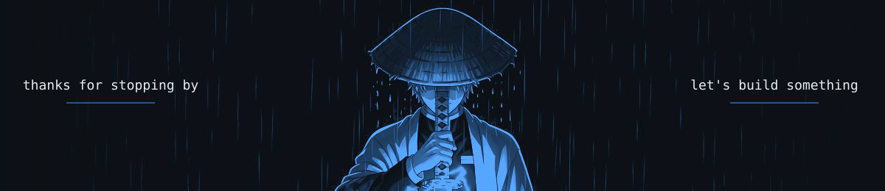

 

 

## 👋 About Me

I'm an **AI/ML Engineer** (B.Tech in AI & ML, 2026) who enjoys building things with language models, from multi-agent systems to classic NLP pipelines. I've worked with real-world survey data at **Kantar** as a research analyst, so I care about clean data and results that hold up outside a notebook.

- 🔭 Building: **LLM agents** and **RAG** applications
- 🌱 Sharpening: **Python · RAG · Generative AI · LLMs · NLP · Deep Learning**
- 🎯 Looking for: **AI Engineer / AI-ML Engineer** opportunities
- 📫 Reach me: **luckysatyawali4@gmail.com**

 

## 🧰 Tech Stack

<h4>Languages & Data</h4>

  
   
  
  

<h4>ML / Deep Learning / GenAI</h4>

  
   
  
  
  
  
  

<h4>Web & Tools</h4>

  

 

## 🚀 Featured Projects

<table>
  <tr>
    <td width="50%" valign="top">
      <h3>🛡️ Cybersecurity Intelligence Agent</h3>
      
A multi-agent LLM threat-intelligence platform built with <b>LangChain</b>. Covers threat detection, vulnerability analysis and automated incident response, with a live React dashboard, threat maps and system health monitoring over REST APIs.

      

        
        
        
        
      

      <a href="https://github.com/luckystw?tab=repositories">View repo →</a>
    </td>
    <td width="50%" valign="top">
      <h3>📧 Email Spam Classifier</h3>
      
NLP text classification using preprocessing, tokenization, stopword removal and <b>TF-IDF</b> with <b>Multinomial Naive Bayes</b>. Reached <b>99% accuracy</b> on the benchmark dataset.

      

        
        
        
      

      <a href="https://github.com/luckystw?tab=repositories">View repo →</a>
    </td>
  </tr>
  <tr>
    <td width="50%" valign="top">
      <h3>🗳️ Blockchain-Based Voting Platform</h3>
      
Tamper-proof e-voting on <b>Ethereum</b> smart contracts with a zero-knowledge-style commitment scheme for voter anonymity. Full-stack app with JWT auth, rate limiting and real-time results.

      

        
        
        
      

      <a href="https://github.com/luckystw?tab=repositories">View repo →</a>
    </td>
    <td width="50%" valign="top">
      <h3>🎓 College ERP Portal</h3>
      
Role-based ERP for admins, teachers and students covering attendance, results and course administration, plus analytics dashboards for tracking outcomes.

      

        
        
        
      

      <a href="https://github.com/luckystw?tab=repositories">View repo →</a>
    </td>
  </tr>
</table>

 

## 📈 Currently Learning

| Focus | What I'm working on |
| :-- | :-- |
| **RAG** | Retrieval pipelines, chunking, embeddings, vector stores, evaluation |
| **LLMs & GenAI** | Prompting, agents, tool use, fine-tuning with Hugging Face |
| **NLP** | Transformers, BERT-style models, text classification |
| **Deep Learning** | PyTorch, CNNs, RNNs, training and debugging models |
| **Python** | Clean, testable, production-minded code |

 

## 💼 Experience

**Research Analyst, Secondary Research** · *Kantar, Gurugram* · Mar 2026 – Oct 2026
Cleaned and analyzed large multi-source survey datasets in Python, SQL and Excel, studied public sentiment and demographic patterns, and built Power BI dashboards and automated reports for stakeholders.

 

## 📊 GitHub Stats

 

## 🎓 Education & Certifications

- **B.Tech, Artificial Intelligence & Machine Learning**, DPG Institute of Technology and Management (2022 – 2026)
- Python for Data Science, **IBM**
- AWS Knowledge: Cloud Essentials, **Amazon Web Services**
- AWS Cloud Clubs Machine Learning Camper, **Amazon Web Services**

 

